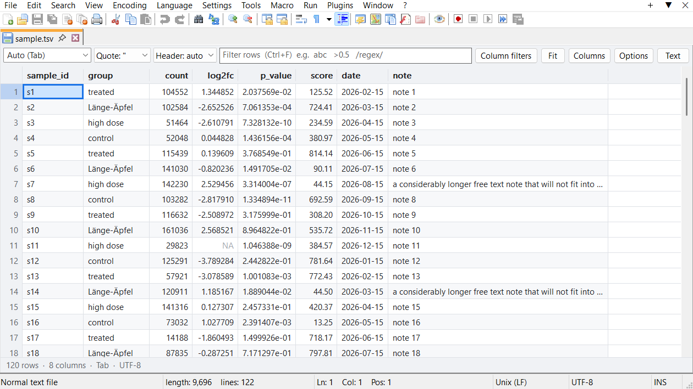
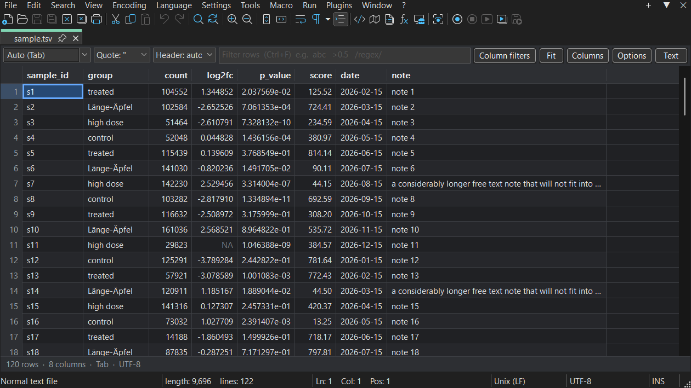

# xsvViewer++

A Notepad++ plugin that shows CSV, TSV and other delimited files as a table you can adjust, right in
the tab. One shortcut flips between the table and the text.

- **Reads your file as it is:** detects the delimiter, quotes, header row, comment lines and decimal
  commas, and lets you override each of them.
- **Handles large files:** a 63 MB file with 1 million rows opens in about 2 seconds and sorts in under
  half a second, because only the rows on screen are ever drawn.
- **Sort and filter:** by clicking a header, by text, by number (`>0.5 & <1`) or by regular expression.
- **Adjust everything:** move, resize, hide and freeze columns; set alignment and decimals per column;
  change fonts, spacing and every colour. Your column layout is remembered for each file.
- **Colour by value:** turn numeric columns into a heatmap, per column or across the table.
- **Safe to read:** the text under a table is locked, so a stray keystroke can't change what you can't
  see. Your other Notepad++ shortcuts keep working.

It knows the formats scientific and spreadsheet work tends to produce: R's `write.table` header that is
one field short, `NA` and other missing values, semicolon files with decimal commas, VCF-style `##`
preambles, and tables with thousands of columns.

|  |  |
| --- | --- |
| Filter by text and by number | Colour numbers by value |
|  |  |
| Follows Notepad++'s dark mode | Docked panel next to the text |

## Install

**Notepad++ 8.9.8.1 or later, 64-bit.**

Until the plugin is listed in **Plugins > Plugins Admin**, install it by hand:

1. Download `xsvViewer-1.0.0-x64.zip` from [Releases](https://github.com/mgalhu/xsvViewer/releases).
2. Close Notepad++.
3. Create the folder `%PROGRAMFILES%\Notepad++\plugins\xsvViewer`. In a portable Notepad++, that is
   `plugins\xsvViewer` in its own folder.
4. Extract the zip into that folder, so that `xsvViewer.dll` sits directly in it.
5. Right-click `xsvViewer.dll`, choose **Properties**, tick **Unblock** if it is shown, and click **OK**.
   Windows won't let Notepad++ load a downloaded DLL otherwise.
6. Start Notepad++. The plugin appears under **Plugins > xsvViewer++**.

The folder and the DLL must both be called `xsvViewer`. The [User Guide](docs/USER_GUIDE.md#installing)
has the other ways to install, and how to remove the plugin.

## Quick start

Open a `.csv`, `.tsv`, `.tab` or `.psv` file: it appears as a table.

| Key | Action |
| --- | --- |
| `Ctrl+Alt+T` | Switch between table and text |
| `Ctrl+Alt+Shift+T` | Show the table in a docked panel, next to the text |
| `Ctrl+F` | Filter rows |
| `Ctrl+Shift+L` | Filter per column |
| `Enter` | Show this cell in the text |
| `Ctrl+C` | Copy the selection |

Click a column header to sort, and right-click it for that column's settings. Everything else is in
**Plugins > xsvViewer++ > Options**.

## Documentation

- **[User Guide](docs/USER_GUIDE.md):** everything the plugin does, every key, filter and option
- **[Development](docs/DEVELOPMENT.md):** building, testing, how it works, making a release
- **[Changelog](CHANGELOG.md)**

Found a bug or have an idea? [Open an issue](https://github.com/mgalhu/xsvViewer/issues).

## License

Copyright (C) 2026 Markus Galhuber. Licensed under the [GPL-3.0](LICENSE), as it builds on the
Notepad++ plugin headers.
