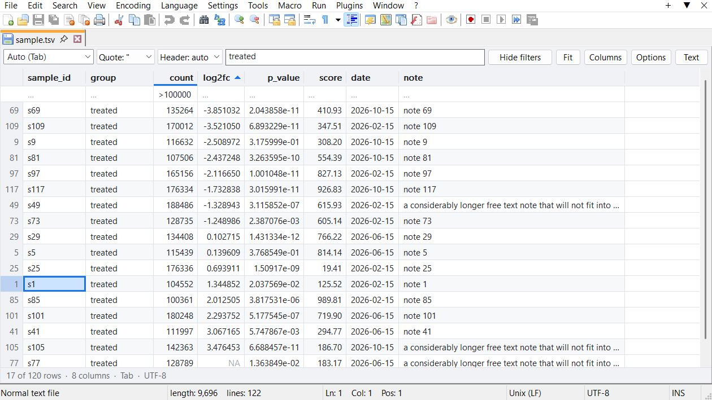
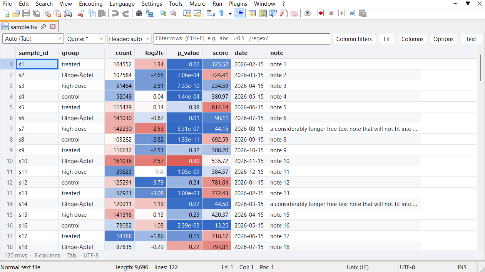
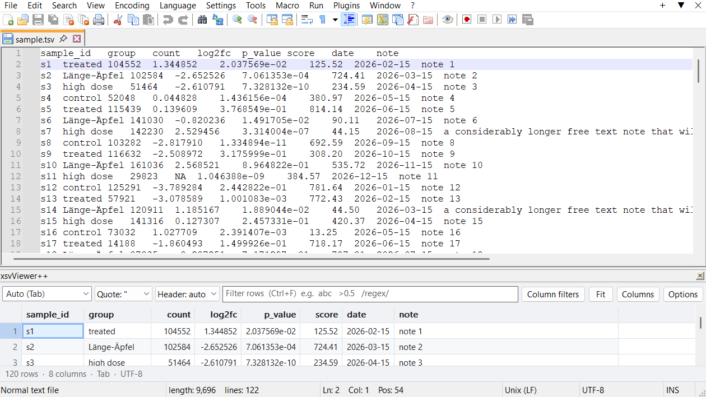
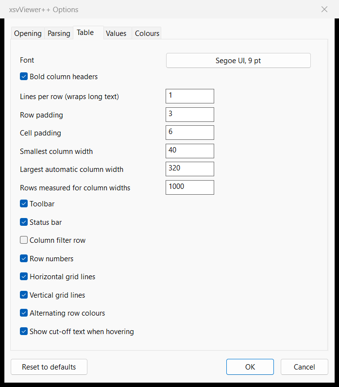

# xsvViewer++ User Guide

xsvViewer++ shows delimited text files as a table inside Notepad++. This guide covers everything it
does. For a short overview, see the [project page](https://github.com/mgalhu/xsvViewer).

- [Installing](#installing)
- [Table and text](#table-and-text)
- [Reading a file](#reading-a-file)
- [Moving around and selecting](#moving-around-and-selecting)
- [Columns](#columns)
- [Sorting](#sorting)
- [Filtering](#filtering)
- [Showing values](#showing-values)
- [Copying and exporting](#copying-and-exporting)
- [The docked panel](#the-docked-panel)
- [Options](#options)
- [Where settings are kept](#where-settings-are-kept)
- [Known limitations](#known-limitations)
- [Troubleshooting](#troubleshooting)

## Installing

xsvViewer++ needs the 64-bit Notepad++, version 8.9.8.1 or later. **? > About Notepad++** shows yours.

**With Plugins Admin**, once the plugin is listed there: open **Plugins > Plugins Admin**, tick
**xsvViewer++** on the **Available** tab, and click **Install**. Notepad++ restarts with the plugin.

**By hand:** download the zip from [Releases](https://github.com/mgalhu/xsvViewer/releases), and with
Notepad++ closed, extract it so that the DLL ends up here:

| Notepad++ | Path |
| --- | --- |
| Installed | `%PROGRAMFILES%\Notepad++\plugins\xsvViewer\xsvViewer.dll` |
| Portable | `<portable folder>\plugins\xsvViewer\xsvViewer.dll` |

Then right-click `xsvViewer.dll`, choose **Properties**, tick **Unblock** if it is shown, and click
**OK**. Windows won't let Notepad++ load a downloaded DLL otherwise.

**With Settings > Import > Import plugin(s):** choose `xsvViewer.dll`, then exit and restart Notepad++.
This copies only the DLL, which is all the plugin needs, but leaves out this guide.

Writing to `Program Files` needs administrator rights. For Plugins Admin or Import, that may mean
starting Notepad++ with **Run as administrator**. On a managed PC, ask whoever looks after it to install
the plugin.

**To remove it:** use **Plugins > Plugins Admin**, tab **Installed**, then **Remove**. By hand, delete the
`xsvViewer` folder while Notepad++ is closed. Your settings stay behind in the files listed under
[Where settings are kept](#where-settings-are-kept); delete those too for a clean start.

When installed through Plugins Admin, a copy of this guide is in `plugins\doc\xsvViewer`.

## Table and text

Files ending in `.csv`, `.tsv`, `.tab` or `.psv` open as a table by themselves. Any other file can be
shown as a table with `Ctrl+Alt+T`, which switches between table and text. So does the **Text** button
in the toolbar.

The table and the text are the same document. Switching keeps your place: the cell under the caret
becomes the selected cell, and the selected cell becomes the caret position. Press `Enter` or
double-click a cell to go straight to that cell in the text.

**xsvViewer++ is a reader.** You can't edit cells. To change data, switch to the text, edit it, and
switch back; the table updates.

**The text is locked while the table covers it.** Otherwise `Ctrl+V` or `Delete` would change text you
can't see. The lock ends when you switch to the text. Notepad++'s own commands that don't change the
text, such as save (`Ctrl+S`), new tab, or switching tabs, work as usual.

The toolbar has, from left to right: the delimiter, the quote character, the header setting, the row
filter, **Column filters**, **Fit** (back to automatic column widths), **Columns**, **Options** and
**Text**. In a narrow view, the less important ones make room for the filter.

The status bar shows how many rows and columns are visible, the delimiter and the encoding. It also
warns about what the file itself gets wrong, such as `3 uneven rows` or `1 unclosed quotes`. When
several cells are selected, it adds their count, sum, mean, minimum and maximum.

## Reading a file

Everything below is detected from the start of the file. Each detection can be overridden: in the
toolbar for the current file, or in **Options > Parsing** for all files. A setting made in the toolbar
is remembered for that file. **Plugins > xsvViewer++ > Reset Layout of This File** forgets it.

**Delimiter.** Tab, comma, semicolon and pipe are detected by which one divides the lines most
consistently. The file extension settles ties. Other delimiters, including space, can be picked or
typed into the delimiter box: any text works, such as `::` or `\t`. The box shows `Auto (Tab)` with
what was detected.

**Quotes.** Quoted cells may contain delimiters and line breaks, and `""` inside quotes means one
quote. A quote that is never closed counts as ordinary text, so it can't swallow the rest of the file.
Such cases are counted in the status bar.

**Header.** The first row is taken as the header when it has text above numeric columns. If a table has
only text, the first row is taken as a header too. Numbers above numbers mean there is no header, and
the columns are called `Column 1`, `Column 2` and so on. A file with a single row is treated as data.

**R row names.** R's `write.table` writes a header with one field fewer than the rows, because the row
names have no heading. This is detected, and the first column is called `row.names`, so the columns
line up. The status bar shows `R row names`.

**Trailing delimiters.** Rows that end in a delimiter have the same shape as R's short header, but
their last cell is always empty. These files are read normally and get an empty last column.

**Comments.** `#` lines at the start of a file are skipped. In a VCF-style file with `##` lines followed
by one `#CHROM` line, that line is kept as the header. **Options > Parsing** can skip a fixed number of
lines, or use another comment prefix.

**Missing values.** Empty cells and the values `NA`, `N/A`, `#N/A`, `NaN`, `nan`, `null`, `NULL`, `None`
and `.` count as missing. They are dimmed, stay at the bottom when sorting, and are left out of
statistics. The list is in **Options > Parsing**.

**Numbers.** A column counts as numeric when, in its first 5000 rows, at most 5% of the non-missing
cells are not numbers. Numeric columns are right-aligned. Scientific notation and `Inf` are understood.

**Decimal commas and thousands separators.** With a comma in the numbers, there are two readings:

| In the file | Read as |
| --- | --- |
| `1,5` | 1.5, a decimal comma |
| `1.234,5` | 1234.5 |
| `1,234,567.5` | 1234567.5 |
| `709,037` | 709037, unless the file uses semicolons or has clear decimal commas |

Three digits after one comma could be either, so semicolon files read `1,250` as 1.25 and other files
read it as 1250. If this guesses wrong, set **Decimal comma** in **Options > Parsing**. The status bar
shows `decimal comma` when that reading is active.

## Moving around and selecting

| Key | Action |
| --- | --- |
| Arrow keys | Move one cell |
| `Ctrl`+arrow | Jump to the edge of the table |
| `Page Up`, `Page Down` | Move one screen |
| `Home`, `End` | First or last column of the row |
| `Ctrl+Home`, `Ctrl+End` | First or last cell of the table |
| `Tab`, `Shift+Tab` | Next or previous column |
| `Shift`+any of these | Extend the selection |
| `Ctrl+A` | Select everything |

| Mouse | Action |
| --- | --- |
| Click a cell, drag | Select cells; dragging past the edge scrolls |
| `Shift`+click | Extend the selection |
| Click a row number, drag | Select rows |
| Click the top-left corner | Select everything |
| `Ctrl`+click a header | Select the column |
| Wheel | Scroll up and down |
| `Shift`+wheel | Scroll sideways |
| `Ctrl`+wheel, `Ctrl`+`+`, `Ctrl`+`-` | Zoom |
| Hover over cut-off text | Show the whole text |

Row numbers count data rows in the file, so they stay the same when sorting or filtering.

## Columns

| To | Do this |
| --- | --- |
| Move a column | Drag its header |
| Resize a column | Drag the right edge of its header |
| Fit a column to its content | Double-click that edge |
| Fit all columns | **Fit** in the toolbar |
| See every column at once | **Columns** in the toolbar |

Right-click a header for that column's settings:

- **Sort ascending**, **Sort descending**, **Clear sort**
- **Filter this column** and **Select column**
- **Alignment:** automatic, left, center or right
- **Decimals:** the default, as in the file, or 0 to 8
- **Fit width**, **Fit all columns**, **Set width**
- **Freeze up to this column:** this column and those left of it stay in place when scrolling sideways.
  **Unfreeze** ends that.
- **Hide column**, **Show all columns**, **Columns**

**Columns** opens a list of all columns, which helps with wide tables. Type to search, tick to show or
hide, and use **Move up** and **Move down** to reorder. Double-click a column to jump to it.

All of this is remembered per file. See [Where settings are kept](#where-settings-are-kept).

## Sorting

Click a header to sort ascending, again for descending, and again to return to the file's order. To
sort by several columns, `Shift`+click the next ones; a small number in the header shows the order.

- Numbers sort by value, and before text.
- Text sorts naturally, so `s2` comes before `s10`, and ignores case. **Options > Values** can turn this
  off, which gives a plain byte-by-byte order.
- Missing values stay at the bottom in both directions.
- Rows that are equal keep their order from the file.

Sorting only changes the view, never the file.

## Filtering

There are two kinds of filter, and they work together: a row is shown when it passes all of them.

- **Row filter:** the box in the toolbar (`Ctrl+F`) searches all columns.
- **Column filters:** `Ctrl+Shift+L` or **Column filters** shows a row under the headers with one filter
  per column. Click a cell in it, or press `F2`, and type. `Tab` moves to the next column, `Enter` goes
  back to the table. A filtered column is marked under its header.

`Esc` in the table clears all filters. The status bar shows how many rows are left, such as
`17 of 120 rows`. A filter that can't be understood, such as a broken regular expression, filters
nothing; in the column filter row, its cell turns red.

You can also right-click a cell and choose **Show only this value** or **Hide this value**.

Both kinds use the same syntax:

| Filter | Keeps cells that |
| --- | --- |
| `abc` | contain `abc` |
| `!abc` | don't contain `abc` |
| `=abc` | are `abc`, ignoring case; numerically if both are numbers, so `=1` matches `1.0` |
| `!=abc` | are not `abc` |
| `>1`, `>=1`, `<1`, `<=1` | are numbers in that range; text and missing cells never match |
| `/regex/` | match the regular expression |
| `/regex/i` | match it, ignoring case |
| `a & b` | meet both |
| `a \| b` | meet either; `&` binds tighter, so `a & b \| c` is `(a & b) \| c` |
| `==abc` | are exactly `abc`, including case |
| `!==abc` | are anything else |

Some details:

- `&` and `|` need a space on both sides, so `R&D` is plain text.
- `==` and `!==` take everything after them literally, including spaces, `&` and `|`. With nothing after
  them they match empty cells: `==` shows the empty ones and `!==` hides them.
- To search for a character that means something here, start with a backslash: `\>5` finds the text `>5`.
- Filters ignore case unless **Case-sensitive filters** is on in **Options > Values**.
- Regular expressions use ECMAScript syntax and look at the first 8192 bytes of a cell.

Examples:

| To find | Filter |
| --- | --- |
| Significant p-values | `<0.05` |
| Values in a range | `>=1 & <=2` |
| Either of two groups | `control \| treated` |
| Sample names like `s1` to `s99` | `/^s\d{1,2}$/` |
| Cells that are filled in | `!==` |

## Showing values

**Decimals.** **Options > Values** sets how many decimals are shown, and a column's menu can override
that. This only changes what you see: copying and exporting still use the file's values. Whole numbers
such as counts, years and IDs are left alone. A value too small for the chosen precision switches to
scientific notation, so `1.2e-08` never reads as `0.000`.

**Thousands separators** can be added in **Options > Values**. They follow the file's decimal style.
Numbers with leading zeros, such as `01234`, are left as they are.

**Colouring by value** is in **Options > Values**, under **Colour numbers by value**. **Per column**
scales each column by itself. **Whole table** uses one scale, which suits a matrix of comparable
values. When values are both negative and positive, the middle colour sits at zero, which suits log fold
changes and z-scores. The three colours can be changed.

**Long text.** Text that doesn't fit ends in `…`; hover over it to read it all. Set **Lines per row**
above 1 in **Options > Table** to wrap text instead. Line breaks inside a cell show as `↵`.

## Copying and exporting

| Key | Copies |
| --- | --- |
| `Ctrl+C` | The selection, separated by tabs |
| `Ctrl+Shift+C` | The same with the column headers |

Right-click a cell for **Copy as CSV** and **Copy as Markdown table**. Tab-separated text pastes straight
into spreadsheets. Copying follows the view: sorted, filtered, in the current column order, without
hidden columns. Values are copied as they are in the file, not as displayed.

**Plugins > xsvViewer++ > Export View as CSV, TSV or Markdown** writes everything currently visible to a
new tab, the same way.

## The docked panel

`Ctrl+Alt+Shift+T` shows the table in a panel, with the text still visible and editable.

- The panel follows the active tab, and updates as you type.
- Moving the caret in the text selects the matching cell. **Options > Opening** can turn this off.
- `Enter` in the panel moves the caret to that cell in the text.
- Like any Notepad++ panel, it can be dragged to another side or floated, for example onto a second
  monitor. It reopens with Notepad++ if it was open when you closed it.

## Options

**Plugins > xsvViewer++ > Options**. Each change applies at once, so the table behind the dialog is a
live preview. **OK** keeps the changes, **Cancel** undoes them all, and **Reset to defaults** restores
the values below.

### Opening

| Option | Default | Effect |
| --- | --- | --- |
| Open these files as a table automatically | on | Off: everything opens as text |
| File extensions | `csv;tsv;tab;psv` | Which files open as a table, separated by `;` |
| Update the table when the text changes | on | Off: it updates when you come back to the tab |
| Remember columns and parsing for each file | on | See [Where settings are kept](#where-settings-are-kept) |
| Panel selects the cell at the text caret | on | See [The docked panel](#the-docked-panel) |

### Parsing

These apply to files without settings of their own.

| Option | Default | Effect |
| --- | --- | --- |
| Delimiter | Detect | Or tab, comma, semicolon, pipe, space |
| Quote character | Double quote | Or single quote, or none |
| Escape character | None | Or backslash, as in `\"` |
| Doubled quotes stand for one quote | on | `""` inside quotes |
| First row is a header | Detect | Or yes, or no |
| Header one field short (R row names) | Detect | Or yes, or no |
| Decimal comma | Detect | Or yes, or no |
| Detect # comment lines | on | Off: use the prefix below instead |
| Comment prefix | empty | Lines starting with this are skipped |
| Lines to skip at the start | 0 | Skipped before anything else |
| Trim spaces around cells | off | Quoted cells keep theirs |
| Skip blank lines | on | Off: they become empty rows |
| Missing values | `NA;N/A;#N/A;NaN;nan;null;NULL;None;.` | Separated by `;`; empty cells always count |

### Table

| Option | Default | Effect |
| --- | --- | --- |
| Font | Segoe UI, 9 pt | Also changed by zooming |
| Bold column headers | on | |
| Lines per row | 1 | Above 1, long text wraps within this height |
| Row padding | 3 | Space above and below the text |
| Cell padding | 6 | Space left and right of the text |
| Smallest column width | 40 | For automatic widths |
| Largest automatic column width | 320 | Longer text is cut off, and a column can still be dragged wider |
| Rows measured for column widths | 1000 | From the top of the file |
| Toolbar | on | `Ctrl+F` brings it back when hidden |
| Status bar | on | |
| Column filter row | off | Same as `Ctrl+Shift+L` |
| Row numbers | on | |
| Horizontal grid lines | on | |
| Vertical grid lines | on | |
| Alternating row colours | on | |
| Show cut-off text when hovering | on | |

### Values

| Option | Default | Effect |
| --- | --- | --- |
| Right-align number columns | on | |
| Decimals shown | As in the file | Or 0 to 8 |
| Thousands separators | off | |
| Dim missing values | on | |
| Colour numbers by value | Off | Or per column, or whole table |
| Colour for low, middle and high values | blue, white, red | |
| Natural sort | on | `s2` before `s10` |
| Case-sensitive filters | off | |

### Colours

**Theme** follows Notepad++, or stays light or dark. Below it, each colour has two swatches, for light
and dark: background, text, header background and text, grid lines, alternate rows, selection and
selected text, cell cursor, row number background and text, frozen column line, missing values and
accent. Click a swatch to change it.

## Where settings are kept

Two files in Notepad++'s plugin configuration folder, normally
`%APPDATA%\Notepad++\plugins\config`:

- `xsvViewer.ini` holds the options.
- `xsvViewer.layouts.ini` holds the settings of each file: column widths, order, hidden columns,
  freezing, alignment, decimals and parsing. It keeps the 500 most recently changed files.

Sorting and filters are not remembered. Reopening a file with rows hidden by a filter you've forgotten
about would make the data look wrong.

If a file gains or loses columns, its layout is kept for the columns that still exist. **Reset Layout of
This File** starts that file over.

## Known limitations

- **64-bit only**, and tested on Notepad++ 8.9.8.1.
- **Notepad++'s Find and Go To work on the hidden text.** They move the caret, but the table doesn't
  follow. Switch to the text to use them. `Ctrl+F` in a table is the row filter.
- **An encoding change** reaches the table the next time you switch tabs or toggle the table.
- **Large files are handled on the main thread.** Sorting or filtering millions of rows takes a second
  or so, during which Notepad++ doesn't respond.
- **The table keeps its own copy of the text,** so a file takes about twice its size in memory.
- **Number detection** uses a column's first 5000 rows, so numbers that only start later leave it as
  text.
- **Very long cells** are drawn up to 1024 characters, and shown up to 4000 when hovering. Copying and
  exporting always use the full text.
- **Ignoring case** covers ASCII, plus Latin letters such as `Ä` in UTF-8 files. In ANSI files, accented
  letters must match exactly.

## Troubleshooting

**The plugin isn't in the Plugins menu.** The DLL must be at `plugins\xsvViewer\xsvViewer.dll`, with
exactly that folder name, and it must be the 64-bit Notepad++. After installing by hand, check that the
DLL is unblocked, as described under [Installing](#installing). If Notepad++ reports that it can't load
the plugin, your version may be too old.

**The columns are wrong.** Choose the delimiter in the toolbar. If rows look merged or split, try
`Quote: none`, because a stray quote at the start of a cell can span several lines.

**The header is treated as data, or data as a header.** Use `Header: yes` or `Header: no` in the toolbar.

**The columns are shifted by one.** The row names detection guessed wrong. Set **Header one field short
(R row names)** in **Options > Parsing**.

**A number column sorts like text.** Look at the status bar for `decimal comma`, and set **Decimal
comma** in **Options > Parsing** if it's wrong.

**Typing does nothing.** The table is showing and the text is locked. Press `Ctrl+Alt+T`.

**A file should open as text.** Press `Ctrl+Alt+T`, or remove its extension in **Options > Opening**.

**A file looks wrong after changing settings.** **Plugins > xsvViewer++ > Reset Layout of This File**.

Something else? [Open an issue](https://github.com/mgalhu/xsvViewer/issues). Please don't attach files
with personal or confidential data; a few made-up lines of the same shape are enough.
